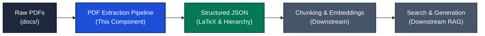

# PDF Extraction Pipeline

A tool for converting STEM textbooks and technical PDFs into structured JSON. It extracts text, headings, tables, and mathematical formulas (as LaTeX) while preserving document reading order and hierarchy.

Powered by [Docling](https://github.com/DS4SD/docling) and IBM's [Granite Docling 258M](https://huggingface.co/ibm-granite/granite-docling-258M) vision-language model.

---

## Table of Contents

- [What It Does](#what-it-does)
- [Role in a RAG Pipeline](#role-in-a-rag-pipeline)
- [Requirements & Installation](#requirements--installation)
- [Quick Start](#quick-start)
- [Hardware Configuration Guide](#hardware-configuration-guide)
- [Input & Output](#input--output)
- [Python API](#python-api)
- [Testing](#testing)
- [Roadmap](#roadmap)
- [Troubleshooting](#troubleshooting)
- [License](#license)

---

## What It Does

- **Extracts Math:** Preserves both inline formulas (`$...$`) and block equations (`$$...$$`) in clean LaTeX syntax.
- **Maintains Structure:** Captures chapters, section headers, paragraphs, and tables in their correct reading order.
- **Smart Skipping:** Automatically checks file timestamps and only processes new or updated PDFs.
- **Runs on Modest Hardware:** Pre-configured to run locally on systems with limited GPU memory (such as 4 GB VRAM) or directly on CPU.

---

## Role in a RAG Pipeline

In a Retrieval-Augmented Generation (RAG) system for technical subjects (math, science, engineering), answer quality depends directly on extraction quality. If formulas or tables are corrupted during PDF parsing, downstream search and answers will fail.



- **This Component:** Ingests raw PDFs and outputs clean, structured JSON where mathematical formulas stay intact as LaTeX and tables keep their structure.
- **Downstream Components:** Take the structured JSON, split it into chunks without breaking equations, generate embeddings, and search over the content to answer user questions.

---

## Requirements & Installation

### Requirements
- **OS:** Linux or WSL2 (Windows Subsystem for Linux)
- **Python:** 3.13 or higher
- **Package Manager:** [`uv`](https://github.com/astral-sh/uv) (recommended)

### Installation

1. Clone the repository:
   ```bash
   git clone https://github.com/MriteshAdak/pdf-extraction-pipeline.git
   cd pdf-extraction-pipeline
   ```

2. Install dependencies:
   ```bash
   uv sync
   ```

---

## Quick Start

Place your PDF files into the `docs/` folder, then run:

```bash
# Process all new or modified PDFs in docs/
make

# Or run via CLI directly
uv run pdf-extraction-pipeline docs/ --output-dir parsed/
```

Extracted JSON files are saved to the `parsed/` directory (e.g., `parsed/sample.json`).

### Useful Commands

```bash
# Process a single PDF
make parsed/sample.json

# Force re-processing of all files (ignoring cache)
make ARGS="--force"

# Run on CPU instead of GPU
make ARGS="--device cpu"

# Run unit tests
make test

# Delete parsed files and cache
make clean

# List all make targets
make help
```

---

## Hardware Configuration Guide

Local vision-language models can be resource-intensive. This project comes with sensible defaults for budget GPUs, but you can adjust settings to match your system's hardware.

### Available Settings

Settings can be customized in `src/pdf_extraction_pipeline/config.py` (via `HardwareConfig`) or passed directly in Python:

| Setting | Default | Description |
|---|---|---|
| `device` | `"auto"` | Target device: `"auto"`, `"cuda"`, or `"cpu"`. Can also be set via the `--device` CLI flag. |
| `torch_dtype` | `"float32"` | Model precision: `"float32"`, `"float16"`, or `"bfloat16"`. |
| `cuda_use_flash_attention2` | `False` | Enables Flash Attention 2 acceleration if installed on supported GPUs. |
| `generate_page_images` | `True` | Generates rendered page images in the output JSON. |
| `repo_id` | `"ibm-granite/granite-docling-258M"` | Hugging Face model identifier to load. |

---

### Recommended Configurations by System

#### 1. Budget or Older NVIDIA GPUs (e.g., GTX 1650, 4 GB VRAM)
*This is the default configuration.*
- **Settings:** `device="cuda"`, `torch_dtype="float32"`, `cuda_use_flash_attention2=False`
- **Why:** Older GPUs (such as NVIDIA Turing GTX 16-series) do not support `bfloat16`. Keeping `float32` prevents crashes and numerical corruption, while 8-bit model quantization keeps memory usage under 4 GB.

#### 2. Modern NVIDIA GPUs (e.g., RTX 3000 / 4000 series, 8 GB+ VRAM)
- **Settings:** `device="cuda"`, `torch_dtype="bfloat16"` (or `"float16"`), `cuda_use_flash_attention2=True` (if `flash-attn` is installed)
- **Why:** Newer GPUs natively support `bfloat16`, which cuts memory consumption roughly in half and speeds up extraction significantly.

To use this profile, update `src/pdf_extraction_pipeline/config.py` or instantiate `HardwareConfig`:
```python
from pdf_extraction_pipeline import HardwareConfig

config = HardwareConfig(
    device="cuda",
    torch_dtype="bfloat16",
    cuda_use_flash_attention2=True,
)
```

#### 3. CPU Only (or Systems Without NVIDIA GPUs)
- **Settings:** `device="cpu"`, `generate_page_images=False` (optional)
- **Why:** Runs the model on your system processor. Setting `generate_page_images=False` saves system RAM and disk space if you only need the text, math, and tables.

You can run on CPU directly from the command line:
```bash
make ARGS="--device cpu"
# or
uv run pdf-extraction-pipeline docs/ --device cpu
```

---

## Input & Output

### Input
- **Folder:** `docs/`
- **Formats:** Standard `.pdf` or `.PDF` files.

### Output
- **Folder:** `parsed/`
- **Format:** Formatted JSON files following the `DoclingDocument` schema.
- **Key Elements:**
  - `body`: Document hierarchy and reading order (sections, headers, paragraphs).
  - `texts`: Individual text items categorized by label (`paragraph`, `section_header`, `formula`, etc.). Math expressions preserve native LaTeX formatting.
  - `tables`: Tabular structures with rows, columns, and cell spans.
  - `pages`: Page dimensions and layout boundaries.

---

## Python API

You can import and use the pipeline directly in your Python code:

```python
from pdf_extraction_pipeline import (
    BatchService,
    CacheService,
    ConverterService,
    ExtractionService,
    HardwareConfig,
)

# 1. Configure for your system
config = HardwareConfig(
    device="cuda",          # or "cpu"
    torch_dtype="float32",  # use "bfloat16" on newer GPUs
)

# 2. Extract a single PDF
cache_service = CacheService(cache_dir="parsed/")
converter_service = ConverterService(config=config)
extraction_service = ExtractionService(
    converter_service=converter_service,
    cache_service=cache_service,
)

doc_data = extraction_service.extract("docs/sample.pdf")
print("Extracted schema:", doc_data.get("schema_name"))

# 3. Batch extract an entire directory
batch_service = BatchService()
processed_files = batch_service.process_directory(
    input_dir="docs/",
    output_dir="parsed/",
    device="cuda",
)
print(f"Processed {len(processed_files)} document(s).")
```

---

## Testing

Run the test suite with:

```bash
make test
# or
uv run pytest
```

---

## Roadmap

Upcoming work for this component:

- [ ] **Automated + Human Review Component:**
  - **Anti-Pattern Scanning:** Automatically scan extracted JSON for known extraction defects (e.g., corrupted LaTeX formulas, broken table matrices, missing headers, or encoding anomalies).
  - **HTML Verification View:** Convert the extracted JSON into a readable HTML preview page so humans can quickly inspect and verify extraction quality against original documents.

---

## Troubleshooting

### 1. `RuntimeError: "addmm_cuda" not implemented for 'BFloat16'`
- **Cause:** Your GPU (e.g., GTX 1650 or RTX 2060) does not support `bfloat16`.
- **Solution:** Keep `torch_dtype="float32"` in your configuration.

### 2. CUDA Out of Memory (OOM)
- **Cause:** Very dense pages with large images can exceed available GPU memory on 4 GB cards.
- **Solution:** Run on CPU using `make ARGS="--device cpu"` or set `generate_page_images=False` in `HardwareConfig`.

---

## License

This project is licensed under the MIT License. See [LICENSE](LICENSE) for details.
